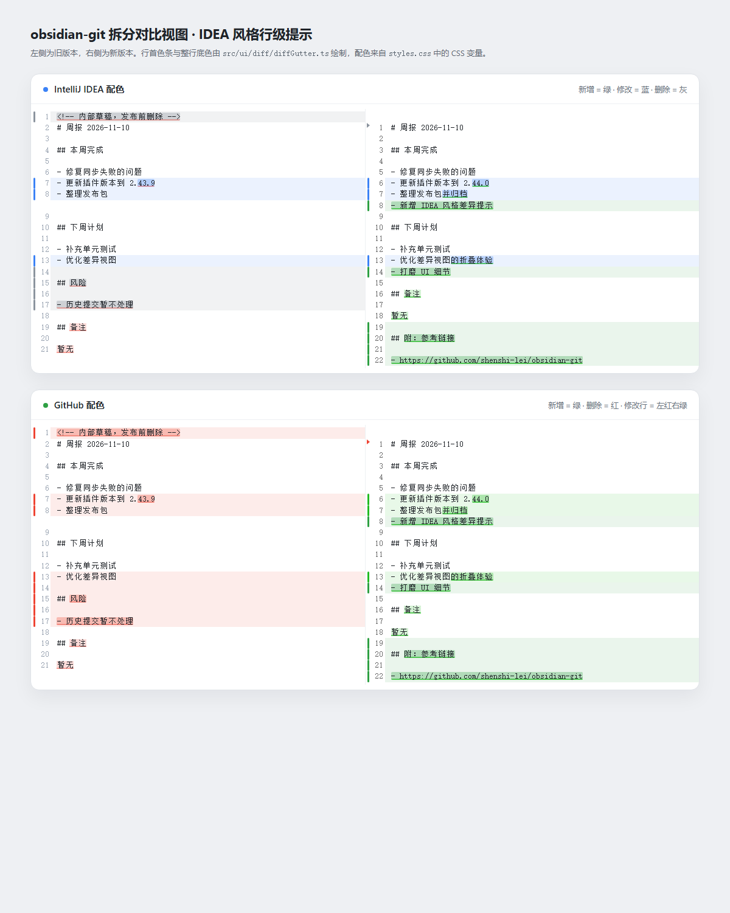
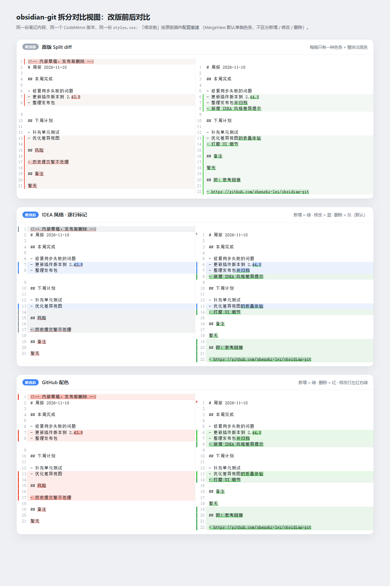

# obsidian-git 拆分对比视图：IDEA 风格逐行修改提示（原型）

结论：**可行，已经实现并验证**。把 Compare/History 里打开的 Split diff 从
「整块变色 + 左右各一种颜色」改成 IntelliJ IDEA 那种逐行标记：

- 新增行：左侧绿色色条 + 淡绿色行底色
- 修改行：左侧色条 + 淡色行底色（IDEA 默认蓝色；GitHub 配色下左侧红色、右侧绿色）
- 删除行：左侧色条 + 行底色（IDEA 默认灰色；GitHub 配色下红色）
- 删除/新增发生在另一侧时，用一个小三角（ghost marker）标出位置
- 行内变动的字词继续保持 CodeMirror 的高亮，颜色跟随所在行状态
- 只标记真正变化的行：diff 块里被顺带包进来的相同行（例如 `## 备注`）不着色



改版前后对比（同一份内容、同一个 CodeMirror 版本、同一份 `styles.css`；
「修改前」按原版插件配置重建）：



## 为什么能改

插件的 Split diff 视图（`src/ui/diff/splitDiffView.ts`）本来就是
CodeMirror 6 的 `MergeView`：两侧各一个 `EditorView`，`@codemirror/merge`
把变更切成一串 `Chunk`。它自带的 `gutter: true` 只能按「这一侧有没有变化」
涂色，区分不了新增/修改/删除，所以本原型：

1. 关闭内置 change gutter（`gutter: false`）；
2. 新增 `src/ui/diff/diffGutter.ts`，基于 `getChunks(state)` + 另一侧文档做
   **逐行对齐**，得到每一行是 added / modified / deleted / unchanged；
3. 每一行画一个自绘 gutter marker（色条或 ghost 三角）并加行级
   `Decoration.line` 底色；
4. 颜色全部走 CSS 变量，IDEA / GitHub 两套配色用容器 class 切换。

## 逐行对齐算法

- 先做**完全相同的行**的最长公共子序列（LCS）对齐，作为锚点（空行权重更低，
  避免一串空行把 `## 备注` 之类的锚点挤掉）；
- 锚点之间的缺口再按字符相似度做一次动态规划配对：
  - 配对成功 → 两侧都是 modified
  - 只有旧侧 → 左侧 deleted
  - 只有新侧 → 右侧 added
- 超过 20000 个格子的大块直接按位置配对，避免大文件卡顿；
- 结果按 `chunks` 数组缓存（编辑器每次内容变化都会生成新数组），
  两侧共用同一份分类，保证左右判断一致。

## 改动文件

| 文件 | 说明 |
| --- | --- |
| `src/ui/diff/diffGutter.ts` | 新增：逐行分类、gutter、行底色、主题（全部视觉规则） |
| `src/ui/diff/splitDiffView.ts` | 挂载 gutter、关闭内置 gutter、应用配色 class、初始化后补一次刷新 |
| `styles.css` | 新增 `--git-diff-*` CSS 变量（IDEA / GitHub 两套） |
| `src/types.ts` / `src/constants.ts` | 新增设置 `diffGutterStyle: "idea" \| "github"`，默认 `idea` |
| `src/setting/settings.ts` | Diff view 分组里新增 “Diff line colors” 下拉框 |
| `demo/` | 浏览器原型（左右两个 MergeView，IDEA 与 GitHub 配色并排） |
| `verify/` | 自动验证脚本（Chunk 对齐、CDP DOM 检查、截图取色） |

## 怎么试

1. 设置 → Git → **Diff view → Diff line colors**：
   - `IntelliJ IDEA (green / blue / gray)`：新增绿 / 修改蓝 / 删除灰（默认）
   - `GitHub (green / red)`：新增绿 / 删除红 / 修改行左红右绿
2. 在 Source Control 或 History 里对任意文件点 Compare / Diff，打开的就是新样式。
   切换配色后需要重新打开该 diff 标签页（视图只在创建时读取设置）。
3. 浏览器里直接看原型：

   ```powershell
   # 已生成 demo/demo.js，直接打开即可
   Start-Process "D:\mywks\session-2026-11-10-obsidian-git-idea-diff\demo\index.html"
   ```

### 重新生成原型

```powershell
& 'D:\nvm\v22.20.0\node.exe' node_modules\@esbuild\win32-x64\esbuild.exe demo\demo.ts `
    --bundle --format=iife --target=es2018 --outfile=demo\demo.js
```

`verify\compact.mjs` + `verify\pixels.py` 可以用 Chrome DevTools 协议重新截图并按坐标取色校验。

## 改版前后对比

- **修改前（原版 Split diff）**：`MergeView` 默认 `gutter: true`，左栏所有改动行用同一种红/橙色条，右栏统一绿色条，配整块淡底色；新增行和修改行看起来一样，删除行只能靠另一侧空位猜。
- **修改后（IDEA）**：逐行分类，新增绿 / 修改蓝 / 删除灰；diff 块里没变的相同行不再着色。
- **修改后（GitHub）**：新增绿 / 删除红 / 修改行左红右绿，适合习惯 GitHub 颜色的场景。

对比页（`demo/compare.html`）里三段用的是同一份内容、同一个 CodeMirror 和同一份插件
`styles.css`，其中「修改前」那段就是按原版插件的 MergeView 配置（不挂载新的
`diffGutter`）重建的，因此颜色和实际旧版一致。

## 验证结果

| 检查 | 结果 |
| --- | --- |
| `tsc --noEmit` | 通过 |
| ESLint（改动文件） | 通过 |
| Prettier（改动 TS 文件） | 通过 |
| 生产构建 | 通过，`main.js` 841,313 字节，产物已含 `git-diff-marker` |
| 浏览器渲染（Chrome CDP） | 两侧色条/ghost 三角均出现，行底色与状态一致 |
| 截图像素校验 | 所有 marker 中心像素与设置的颜色完全一致，0 处不符 |
| 全量测试 | 5 个文件 / 24 个用例失败（217 通过），与改动前基线完全一致（Windows Git 2.43 pathspec、缺 Obsidian 运行时、临时目录/超时等环境原因） |

## 已知限制 / 后续可做

- 逐行对齐是启发式：整行重写、移动块的表现会和 IDEA 略有差异；
- 只改 Split diff；设置里选 `Unified`（diff2html）时仍是原来的样式；
- 中间那列 revert 按钮、折叠未变区块保持原样，没有重新设计；
- 大文件（单块超过 2 万行对）不做相似度对齐，只按位置配对；
- 可继续做：把行内 word 高亮也做成 IDEA 的深一档色、Unified 视图支持、
  增加「只显示标记/同时显示底色」开关、为对齐算法补单测。

## 回滚

安装前已把旧插件备份到 `dist/legacy-2.43.9-before-idea-diff/`，
把其中文件复制回 `<笔记库>/.obsidian/plugins/obsidian-git/` 即可。
