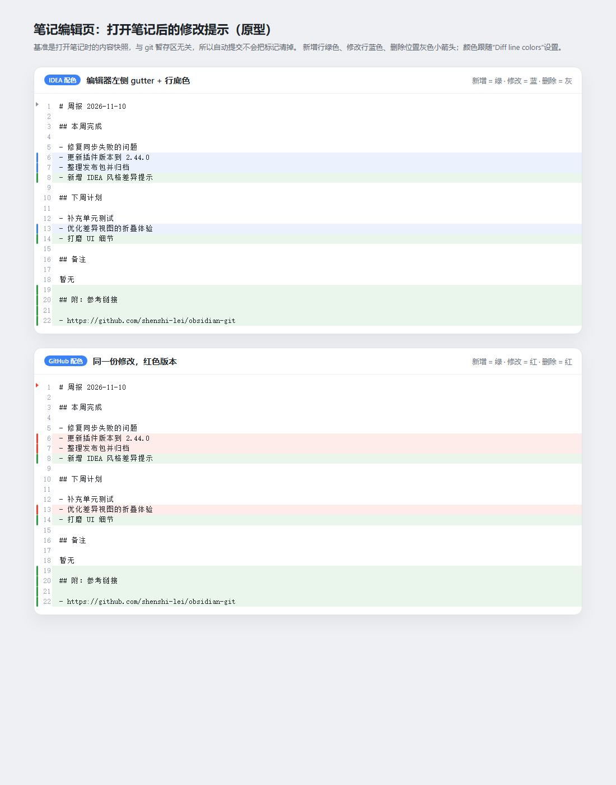
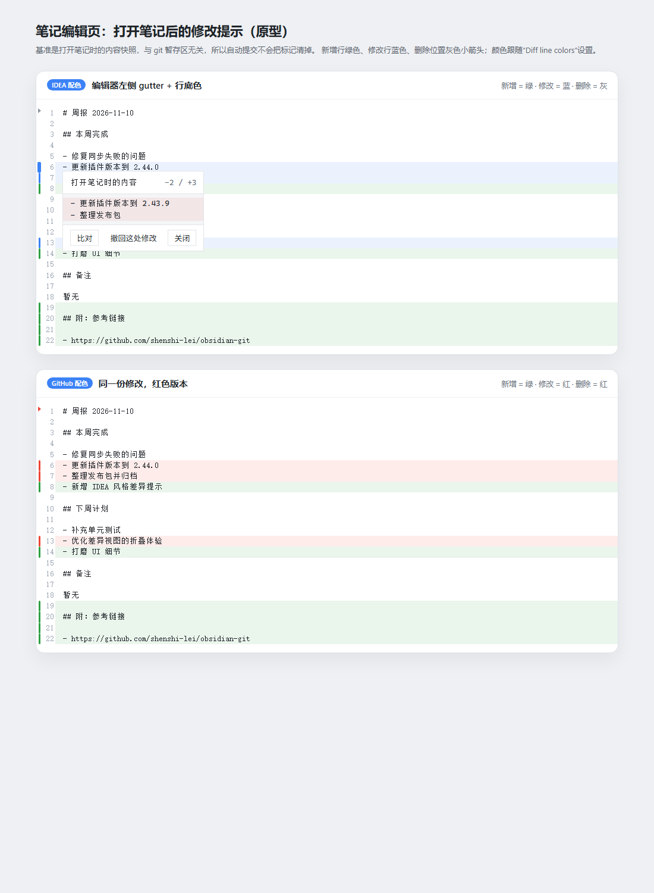

# 笔记编辑页：打开笔记后的修改提示（IDEA 风格）

需求：在**编辑笔记的主页面**（不是 Compare 弹窗）左侧显示 IDEA 那样的逐行修改提示。
难点是自动提交：原来的 Signs 功能对比的是 Git 暂存区，自动提交一跑，index 和工作区一致，标记就没了。
本功能改用**打开笔记时的内容快照**作为基准，完全不碰 git，因此自动提交不会清掉标记。

点击左侧色条会弹出“打开笔记时的内容”，可直接撤回这一处修改：

## 效果

- 新增行：左侧绿色色条 + 淡绿色行底色
- 修改行：左侧蓝色色条 + 淡蓝色行底色
- 删除：在删除位置显示灰色小箭头（行内无法标色，因为行已经不存在）
- 只标记真正变化的行：同一个 diff 块里没变的相同行（如 `## 备注`）不着色
- 点击左侧色条或删除箭头：浮层显示`打开笔记时的内容`（这一段在快照里的原文），
  提供 **比对** 和 **撤回这处修改** 按钮；新增块显示“这里原本没有内容”，撤回即删除这几行
- 撤回通过 CodeMirror 事务执行，`Ctrl+Z` 可以撤销这次撤回
- 配色跟随设置里的 **Diff line colors**：
  - `IntelliJ IDEA`：新增绿 / 修改蓝 / 删除灰（默认）
  - `GitHub`：新增绿 / 修改红 / 删除红

## 基准怎么定

1. 第一次在编辑器里打开某个笔记时，把当前正文存进内存（`src/editor/localChanges/store.ts`）。
2. 之后每次编辑，用这份快照和当前正文做 diff（300ms 防抖，大文件/慢 diff 用 800ms）。
3. 关闭笔记再打开：**同一会话内保留原快照**，所以还能看到之前的修改。
4. 重载插件或重启 Obsidian：快照丢失，重新打开即重置。
5. 改名：`vault.on("rename")` 会把快照迁移到新路径。
6. 自动提交、手动 stage、手动 commit、自动 push/pull：**都不影响**基准。

## 使用

- 设置 → Git → Diff view：
  - **Changes since opening a note**：开关（默认开）
  - **Diff line colors**：配色
- 命令面板：
  - `Toggle changes since opening a note`
  - `Mark changes since opening a note as reviewed`（把当前笔记的基准重置为现在）
- 左侧命令面板（`⌘`）的 Editor 组里也有这两条命令。

## 点击预览与撤回

- 点击左侧任意色条 / 删除箭头：在该行下方弹出浮层
  - 标题：`打开笔记时的内容`
  - 内容：这个 hunk 在快照里的原文（纯新增的块显示“这里原本没有内容”）
  - 计数：`-移除行数 / +新增行数`
- 浮层按钮：
  - **比对**：打开只读的 Split diff，左栏是打开笔记时的快照，右栏是点击“比对”时的内容
  - **撤回这处修改**：用快照原文替换当前这一段（删除行会插回原位），
    只影响当前 hunk；执行后标记立即消失，`Ctrl+Z` 可撤销
  - **关闭**：或点击编辑器空白处 / 按 `Esc` 关闭
- 撤回只修改正文，不改基准快照，所以撤回之后这一段重新变成“没有修改”

## 比对视图

- 入口：
  - 单元格浮层里的 **比对** 按钮（对整篇笔记）
  - 命令 `Compare with note when opened`（编辑器命令；命令面板 Editor 组里也有）
- 视图：复用现有 Split diff（带 IDEA 逐行色条/行底色），标题后缀 `(since opened)`；
  两侧都是只读快照，不显示 stage/reset 按钮
- 两段文本通过内存注册表传给 diff 视图，只把短 id 写进工作区状态，
  避免把整篇笔记塞进 workspace 布局
- 快照是点击那一刻的副本：之后继续编辑，需要重新点“比对”
- 插件重载后内存注册表清空，已打开的比对标签页会提示重新打开并显示为空

## 与原有 Signs 的区别

| | Signs（原有） | 本功能 |
| --- | --- | --- |
| 基准 | Git 暂存区 index | 打开笔记时的内存快照 |
| 自动提交后 | 标记被清空 | 不受影响 |
| 行底色 / 删除箭头 | 只有色条 | 色条 + 行底色 + 删除小箭头 |
| 写操作 | stage/reset hunk | 点击查看原文 + 撤回单个 hunk（不 stage） |
| 跨会话 | 是 | 否（会话内） |
| 默认 | 关 | 开 |

两个功能可以同时开，会并排出现两条 gutter。

## 实现文件

| 文件 | 说明 |
| --- | --- |
| `src/editor/localChanges/store.ts` | 会话快照存储（路径 → 文本），改名迁移、清空 |
| `src/editor/localChanges/classify.ts` | Hunk → 行状态（新增/修改/删除缺口 + hunk 编号） |
| `src/editor/localChanges/revert.ts` | 根据 hunk 计算恢复快照的文本替换（纯函数，有单测） |
| `src/editor/localChanges/localChanges.ts` | CodeMirror gutter、行底色、ghost 箭头、防抖 diff、点击浮层与撤回 |
| `src/editor/localChanges/integration.ts` | 插件接入：按设置启用/停用、改名事件、重置、比对入口 |
| `src/ui/diff/snapshotRegistry.ts` | 比对用的临时文本注册表（只把短 id 放进视图状态） |
| `src/ui/diff/splitDiffView.ts` | 支持 `compareSnapshotId`：只读、跳过 git 刷新、标题 `(since opened)` |
| `src/tools.ts` | `openSnapshotDiff()`：打开两段文本的只读 Split diff |
| `src/editor/diff/lineAlignment.ts` | 从 diff 视图抽出的逐行对齐（锚点 + 相似度） |
| `src/editor/editorIntegration.ts` | 生命周期、设置刷新 |
| `src/setting/settings.ts` / `src/types.ts` / `src/constants.ts` | `showLocalChanges` 设置项、`compareSnapshotId` 视图状态 |
| `src/commands.ts` | 开关、标记已读、与打开时比对三条命令 |
| `styles.css` | 配色变量 + 浮层样式 |
| `tests/localChanges.test.ts` | 18 个单测（分类、撤回编辑、快照存储） |
| `tests/snapshotRegistry.test.ts` | 3 个单测（比对快照注册表） |
| `tests/openSnapshotDiff.test.ts` | 1 个单测（比对入口传递快照 id） |
| `tests/ui/diff/splitDiffView.test.ts` | 新增 3 个快照模式用例（标题、只读、跳过 git 刷新） |
| `demo/editor.html` | 浏览器原型，两套配色，可点击验证浮层/撤回 |

## 验证

| 检查 | 结果 |
| --- | --- |
| `tsc --noEmit` | 通过 |
| ESLint（src + tests） | 通过 |
| Prettier（改动文件） | 通过 |
| 单测 | 32 个相关用例 + splitDiffView 快照模式 3 个，全部通过 |
| 浏览器渲染 + 取色 | 行底色、色条、ghost 箭头位置与颜色全部匹配（0 处不符） |
| 点击 / 撤回（CDP 实测） | 浮层打开并显示快照原文与“比对”按钮；点击“撤回这处修改”后该行恢复为 `2.43.9`，标记数 10 → 7，浮层关闭 |
| 比对入口 | `openSnapshotDiff` 单测验证注册快照并打开 `Split diff`；快照视图只读、标题 `(since opened)` |
| 生产构建 | 通过，`main.js` 855,527 字节；产物已含 `git-local-tooltip` / `compareSnapshotId` |
| 全量测试 | 4 个文件 / 23–26 个用例失败（均为 git 相关的既有环境失败，数量随 CRLF/超时波动；本次新增用例全部通过） |

## 已知限制

- 快照只在内存里：重载插件/重启 Obsidian 后，已开笔记的标记会重置为“无修改”。想要跨重启保留，可以后续换成持久化快照或 Git baseline ref（讨论过的方案 B/C）。
- 只覆盖 Markdown 编辑器的 Codemirror 视图；如果主题或 Obsidian 设置隐藏了 gutter，色条可能不可见，但行底色仍然显示。
- 大块重写时按“相同行锚点 + 相似度”配对，个别行的新增/修改判定会和 IDEA 略有差异。
- 快照会为每个打开过的笔记保留一份全文，会话很长、笔记很大时内存会涨；重载插件或重启即释放。
- 撤回是“恢复快照原文”，不会 stage/commit；只影响点击的那一处 hunk，`Ctrl+Z` 可撤销。
- 比对页是点击“比对”那一刻的静态副本（两侧只读）；要继续看最新修改需重新打开。
- 比对文本只存在内存，重载插件后仍打开着的比对标签页无法恢复内容。
- 不改动原 Signs 功能，两者独立。

## 回滚

本次安装前的插件文件备份在 `dist/legacy-before-local-changes/`，复制回
`<笔记库>/.obsidian/plugins/obsidian-git/` 即可。
